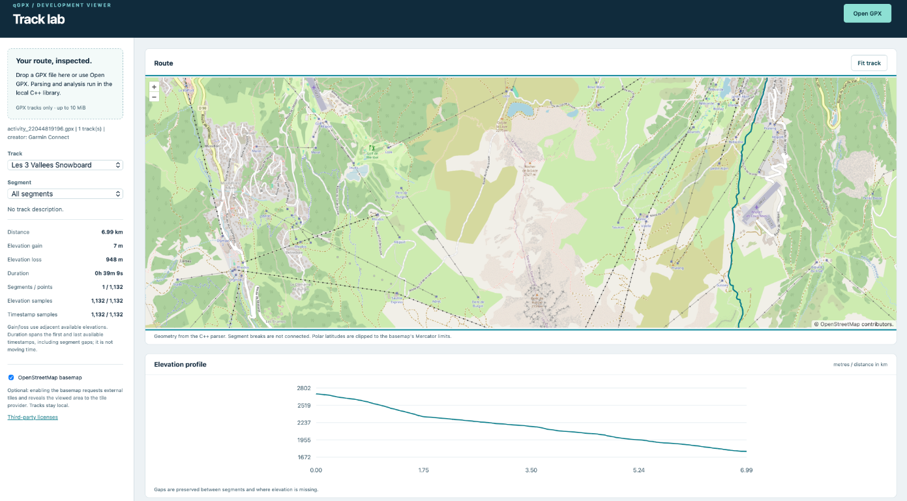

# qGPX

qGPX is a C++17 library for parsing GPX track data and calculating track distance,
elevation gain and loss, and duration. It provides both a C++ API and a C API.
It also derives adjacent-point and maximum speed from coordinates and timestamps.



## Dependencies

- CMake 3.20 or newer
- A C++17 compiler
- Expat
- GoogleTest is fetched by CMake when tests are enabled (the default)

On macOS, install Expat with `brew install expat`. On Ubuntu or Debian, install it
with `sudo apt install libexpat1-dev`.

## Build and test

```sh
cmake -S . -B build
cmake --build build --parallel
ctest --test-dir build --output-on-failure
```

To build only the reusable library, without tests, HTTP code, or UI:

```sh
cmake -S . -B build -DBUILD_TESTS=OFF -DBUILD_VIEWER=OFF
cmake --build build --parallel
```

The `qGPX` target contains only the parser, analytics, and C API. The optional
`qgpx-viewer` executable owns `main()` and links the library through a separate
HTTP adapter. All viewer source lives under `viewer/`, not `src/`.

## Integrating the library

Install the core library and its CMake package:

```sh
cmake -S . -B build/core -DBUILD_TESTS=OFF -DBUILD_VIEWER=OFF
cmake --build build/core --parallel
cmake --install build/core --prefix /path/to/qgpx-install
```

In another project's `CMakeLists.txt`:

```cmake
find_package(qGPX 1 CONFIG REQUIRED)
target_link_libraries(my_app PRIVATE qGPX::qGPX)
```

Configure that project with `-DCMAKE_PREFIX_PATH=/path/to/qgpx-install`.
The imported target supplies the public header path, C++17 requirement, and
Expat link dependency. Expat must also be available on the consuming system.
Use public headers such as `#include <GPXParser.hpp>` or `#include <GPXCore.h>`.
No viewer, HTTP, JSON, Node, or GoogleTest dependency is installed with the core.

Alternatively, include the source checkout directly:

```cmake
add_subdirectory(path/to/qGPX)
target_link_libraries(my_app PRIVATE qGPX::qGPX)
```

Tests default to off when qGPX is a subdirectory; the viewer always defaults to
off. Explicit `BUILD_TESTS` and `BUILD_VIEWER` settings override these defaults.
The [integration fixture](test/integration/) exercises both consumption methods.

## Code formatting

Use `clang-format` with the repository's `.clang-format` rules to format the
maintained C++ files. The commands below cover the public headers, implementation,
and tests:

```sh
clang-format -i include/*.h include/*.hpp src/*.cpp viewer/server/*.cpp viewer/server/*.hpp test/*.cpp test/unit/*.cpp test/viewer/*.cpp test/integration/*.cpp
```

Check formatting without changing files:

```sh
clang-format --dry-run --Werror include/*.h include/*.hpp src/*.cpp viewer/server/*.cpp viewer/server/*.hpp test/*.cpp test/unit/*.cpp test/viewer/*.cpp test/integration/*.cpp
```

Formatting is checked in CI, but is not part of the CMake build or configured to
run on save. CI installs the Ubuntu-provided `clang-format` package; its version is
not pinned.

To enable the repository's pre-commit formatting check in this clone, run once:

```sh
git config core.hooksPath .githooks
```

The hook checks staged C++ files and blocks commits with formatting issues. It
requires `clang-format` to be installed.

## Optional browser viewer

The [local development viewer](viewer/README.md) provides GPX upload, track and
segment selection, a map, statistics, an elevation profile, and 2D replay with
optional camera follow. It uses the C++
library through a loopback-only HTTP adapter; the library itself remains
frontend-independent.

```sh
npm --prefix viewer ci
npm --prefix viewer run build
cmake -S . -B build -DBUILD_VIEWER=ON
cmake --build build --parallel
./build/qgpx-viewer
```

Requires Node.js 24 or newer in addition to the core build dependencies.
Open <http://127.0.0.1:8080>. The optional external basemap is disabled by default.
`BUILD_VIEWER` defaults to `OFF`; core-only consumers do not need Node or the
viewer dependencies. See [third-party licenses](third_party/README.md) for
dependency sources and notices.

## Continuous integration

GitHub Actions runs on pushes and pull requests targeting `main`. It configures and
builds the project with the optional viewer, checks C++ formatting, builds and tests
the frontend, and runs the registered tests with CTest.

## Public headers

- `GPXParser.hpp` parses GPX XML strings and files into the `qGpx::core` data
	model.
- `GPXAnalytics.hpp` calculates distance, elevation change, and duration.
- `GPXAnalytics.hpp` also exposes `calculateSpeed` and `calculateMaxSpeed` in m/s.
  These use adjacent points within segments and ignore invalid timed intervals;
  results are unsmoothed estimates and can reflect GPS spikes.
- `GPXModels.hpp` defines the GPX data, track, segment, point, and result types.
- `GPXCore.h` exposes the C API.
  Its speed accessors (`gpx_track_get_max_speed`, `gpx_segment_get_max_speed`,
  `gpx_segment_get_point_speed`) calculate on demand, without requiring
  `gpx_analyze`, and return `-1` when unavailable.

## License

See [LICENSE](LICENSE).
